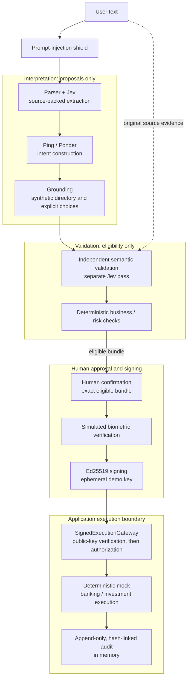

# DCTA — Zero-Trust Conversational Banking

**AI proposes. You review. The gateway verifies.**

Tencent Cloud AI Singapore Hackathon 2026 · DBS Banking Track

## What is DCTA?

DCTA (Direct Conversational Transaction Agent) turns a banking request into a reviewable transaction bundle. For example:

> Buy 5 DBS shares and send SGD 50 to Sarah from savings.

The investment and transfer become separate proposals. Meaning and eligibility are checked before explicit confirmation, signed authorization, and **mock execution**. AI interpretation has no execution authority.

## Why this exists

A model can misread an amount, choose the wrong recipient, or mistake quoted instructions for a request. DCTA makes proposals, source evidence, checks, and human decisions visible before execution becomes available.

## How it works

1. **Describe the request.** Shielded interpretation produces source-backed operation proposals.
2. **Resolve and check.** Clarify names, recheck semantics against the source, and apply deterministic business rules.
3. **Review and authorize.** Confirm the exact eligible bundle, simulate biometric verification, sign and verify, then explicitly authorize.
4. **Execute and inspect.** The gateway permits mock execution with a receipt and audit. Duplicate execution returns the original receipt.

## Architecture



The validator revisits the source and proposed bindings in a separate pass using the **same configured Jev model** in LIVE. Independence means a separate check, not an independent model or accuracy guarantee. Business checks, signature verification, and mock state transitions are deterministic.

These are logical boundaries within one Python process. `SignedExecutionGateway` enforces the submission app's execution path; the directly importable `MixedGateway` has no process/IAM isolation. [Architecture details](docs/ARCHITECTURE.md).

## What makes it zero-trust

- **Evidence before eligibility:** source spans, registered choices, and versions are checked. Semantic discrepancy or uncertainty stops confirmation.
- **Deterministic policy:** synthetic ownership, account/recipient status, currency, balances, and transaction/daily amount/count limits are checked.
- **Exact human intent:** ambiguity requires an explicit choice and fresh checks. Confirmation binds the eligible bundle; changed submissions invalidate prior authority.
- **Signed execution:** Ed25519 binds the review, confirmation, nonce, and actor. The public-key verifier rejects stale or tampered evidence.
- **Controlled outcomes:** mock transfer and investment records commit together. Retries reuse the receipt; an append-only API records hash-linked audit events.

The prompt shield blocks the documented injection scenario before provider calls. It is a bounded defense, not universal injection protection. [Security model](docs/SECURITY.md).

## Demo scenarios

| Preset | What it demonstrates |
|---|---|
| A — Happy mixed intent | Separate investment/transfer cards and the complete signed lifecycle. |
| B — Ambiguous beneficiary | Two Johns require an explicit choice and a new grounding revision. |
| C — Semantic discrepancy | A **SCRIPTED validator fault** freezes the proposal before confirmation. |
| D — Business/risk failure | SGD 5,000 exceeds the synthetic SGD 1,000 transaction limit. |
| E — Prompt injection | An injected memo stops before interpretation progresses. |
| F — Duplicate execution | `ALREADY_EXECUTED`: no second debit or simulated order. |

All six are repeatable SCRIPTED presets. C is unavailable in LIVE and demonstrates gate enforcement rather than detection accuracy. [Demo walkthrough](docs/DEMO.md).

## Quick start

Requires **Python 3.12+**. From the repository root:

```bash
python3.12 -m venv .venv
.venv/bin/python -m pip install -e '.[demo]'
.venv/bin/python -m demo_ui
```

Open Gradio's printed URL, normally `http://127.0.0.1:7860`. **SCRIPTED DEMO** is already selected: no provider credentials or model requests. Select **A. Happy mixed-intent**, click **Load Scenario**, then **Confirm Bundle → Simulate Biometric → Sign & Verify → Authorize → Execute**. Expect `SUCCEEDED`.

### Optional LIVE inference

LIVE makes real TypeSafe Jev requests through OpenRouter; execution remains mock in both modes.

```bash
OPENROUTER_API_KEY="<your-local-key>" .venv/bin/python -m demo_ui --live
```

The badge identifies the selected inference mode. LIVE accepts `typesafe/jev-1.13`; `JEV_MODEL` is optional. See [.env.example](.env.example) and [explicit settings setup](docs/DEMO.md). Never commit a real credential.

To run the existing tests, install `.[demo,test]`, then run `.venv/bin/python -m pytest -q`.

## Limitations

Customers, accounts, balances, recipients, and policies are synthetic; the catalog contains DBS shares only. Identity/biometrics are simulated; signing uses an ephemeral demo key. Investment records have no pricing, funding, cash settlement, or brokerage access.

The executable flow is one transfer plus one investment action. State, idempotency, and audit are process-local and reset with the session. There is no production authentication, durable storage, process/IAM isolation, or real bank integration. LIVE semantic judgment remains probabilistic. [Full limitations](docs/LIMITATIONS.md).

## Built with

Python 3.12+ · Pydantic 2 · Gradio · TypeSafe Jev via OpenRouter Decisions · `cryptography` / Ed25519 · pytest. Parser, Ping, and Ponder are the shipped interpretation components.

**Development tooling:** Tencent CodeBuddy assisted demo UI implementation. Submission evidence is maintained externally and is not stored in this repository.
