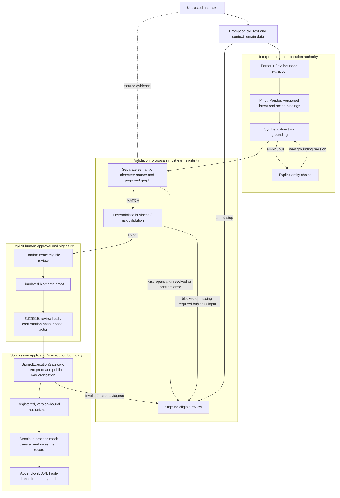

# Architecture and trust boundaries

DCTA separates interpretation, validation, human approval, and execution. The [README diagram](../README.md#architecture) is the judge-facing view. Every boundary below is logical and application-enforced within one Python process; the diagram does not imply separate services, IAM roles, or hardware isolation.

## Interpretation and semantic checks

`DemoSession.submit_text` drives `MixedTextLifecycle`. User text is shielded, then Parser+Jev and Ping supply bounded, source-backed mentions and scope decisions. Ponder assembles versioned intent proposals, including explicit investment actions and mixed operation bindings. Model choices come from registered options; a choice cannot manufacture confirmation, authorization, or execution authority.

Grounding resolves literal names against the synthetic directory. An ambiguous name requires an explicit entity choice. That choice creates a new grounding revision and triggers semantic and business checks again.

The independent semantic observer compares the original source, evidence spans, clarified entities, and complete proposed operation graph. It checks operation count, joint bindings, applicable fields, and explicit investment action. Deterministic integrity checks validate artifacts and replay the observer contract; only `MATCH` reaches business checks. In LIVE, the observer is a separate request to the same configured Jev model, not an independent provider or a deterministic proof of meaning. SCRIPTED supplies canned observer answers.

## Deterministic policy and exact review

Business validation checks synthetic ownership, account/recipient status, supported currency, amount precision, available funds, per-transaction limits, daily outgoing amount, and completed-operation count. Investment eligibility uses the bounded synthetic catalog and policy; it does not price or cash-settle an order.

An eligible review binds both operations, action decisions, source/grounding versions, semantic and business results, and bank/investment context. Human confirmation binds that exact review. A changed submission or grounding/context revision invalidates old authority; returning to older text does not revive it.

## Signing, authorization, execution, and audit

Confirmation, simulated biometric verification, signing, authorization, and execution are distinct actions. `DemoSigner` generates an ephemeral Ed25519 key and signs the review hash, confirmation hash, random nonce, and actor. `SignedExecutionGateway` has the public key, checks current registered evidence, and admits backend authorization only after those checks. Each execution attempt rechecks the signed capability and current generation.

This is the submission app's enforced execution boundary. The underlying `MixedGateway` remains directly importable and has no signature parameter. It is an internal implementation component, not a separate process or IAM security boundary.

Successful execution commits a mock transfer and an inert investment record together in process. Repeating the same current signed execution returns `ALREADY_EXECUTED` with the original receipt and no second debit/order. This is process-local idempotency, not a distributed banking guarantee.

The audit API appends immutable, hash-linked records with artifact references and causal links, and can verify the retained chain. It records events throughout the lifecycle, including failures; its position at the end of the diagram represents the visible outcome. Storage is in memory and is not durable or externally tamper-proof. The UI's simulated biometric/crypto status panel is distinct from backend audit events.

## Shipped implementation map

| Responsibility | Implementation |
|---|---|
| Text front door and UI flow | `demo_ui/app.py`, `demo_ui/orchestrator.py` |
| Prompt shield | `src/dcta/shield/` |
| Extraction, scope, intent, grounding | `src/dcta/ponder_mvp/`, `src/dcta/ponder/`, `src/dcta/mixed/policy.py` |
| Source-based semantic observer | `src/dcta/mixed/validation.py`, `src/dcta/validation/semantic.py` |
| Deterministic policy and exact review | `src/dcta/business/`, `src/dcta/mixed/business.py`, `src/dcta/mixed/review.py` |
| Ed25519 and public execution boundary | `demo_ui/crypto.py`, `demo_ui/signed_gateway.py` |
| Mock execution and audit | `src/dcta/mixed/gateway.py`, `src/dcta/lifecycle/audit.py` |

LIVE uses the existing `SemanticApplicabilityTransport → ActionTargetTransport → RoleTargetTransport → GuardedProvider → DecisionsProvider` chain. SCRIPTED substitutes `ScriptedWireControl` at the provider boundary. Both use the same lifecycle gates and mock backend. See [security](SECURITY.md) and [limitations](LIMITATIONS.md).
